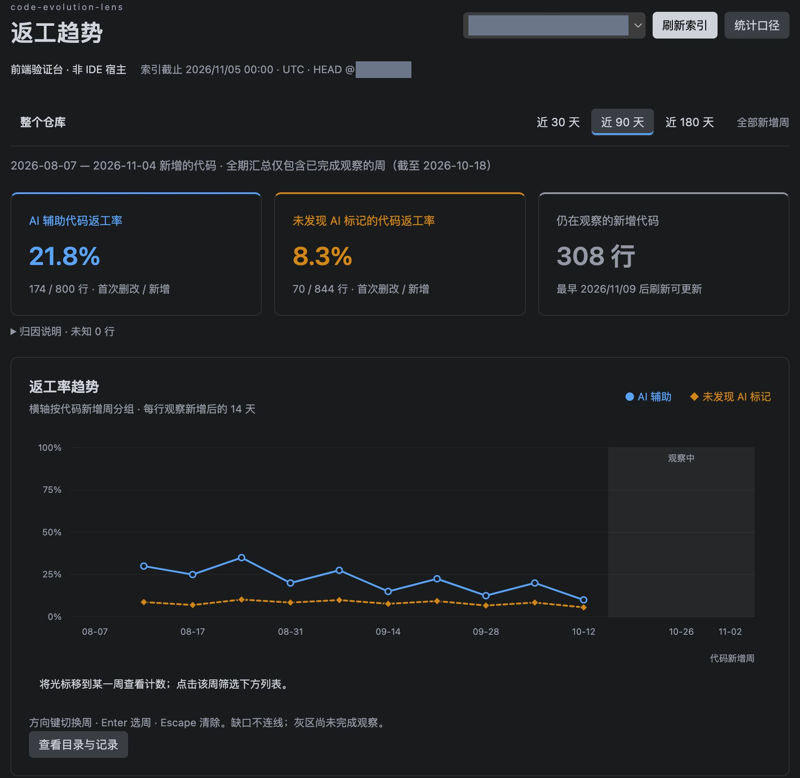
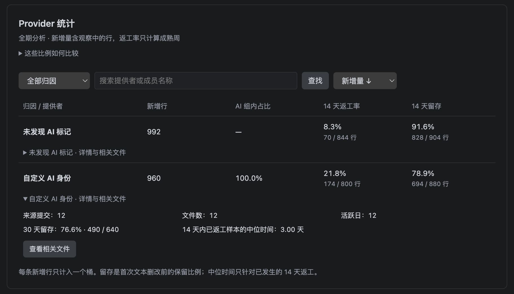
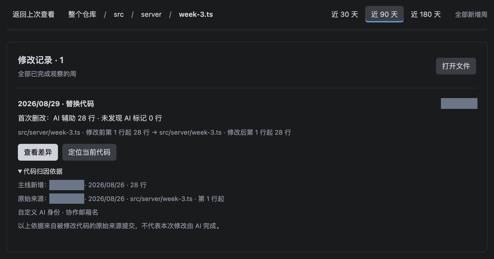

# code-evolution-lens

Development preview **0.3.4**. Inspect code rework, retention, provider statistics, and commit activity in your IDE. Navigate from the whole repository to directories and files, select an addition week, and open the historical diff that supports a metric.

中文说明源码为 `README.md`，安装包内为 `readme.md`；中文 IDE 中执行“code-evolution-lens: 查看统计口径”可打开。

The blue solid curve represents AI-assisted code identified by Git attribution markers. The orange dashed curve represents code without detected AI markers. These groups describe available evidence, not certainty about how every line was written.

## Screenshots

These screenshots show the actual frontend using temporary Git demonstration history, rather than a production repository or native IDE acceptance test. Repository identifiers, author names, and commit identifiers are covered with opaque pixels. The PNGs contain no original pixels beneath the masks or source metadata. Paths such as `src/server` are synthetic.

Repository trends and observation windows:



Provider grouping and code retention:



File modification records and attribution evidence (the demonstrated interface is Chinese):



## Install and Start

1. Install the extension from an available extension marketplace once it has been published, or use **Install from VSIX** with the supplied package. In SSH/container/WSL windows, install it on the remote workspace host.
2. Open and trust a Git repository root. Git must be available on PATH on the host containing the repository.
3. Run **code-evolution-lens: Refresh Index**. Activation does not automatically scan Git history.
4. Use **code-evolution-lens → Repositories and Directories** or **Open Rework Trends** to open the analysis panel.
5. Select 30, 90, or 180 days. Select a week to filter the records below; the full-period summaries and analysis keep their original scope.
6. Drill down to a file and select **View Diff**. Both sides are read-only historical Git contents. **Open File** and **Locate Current Code** are separate actions.

## Interface Language

Chinese is the source language. English translations cover commands, settings, notifications, line-marker hovers, and the analysis panel. The interface follows the IDE display language: `zh-cn` uses Simplified Chinese; English and unsupported languages, including Traditional Chinese, use English.

After changing the IDE display language, restart as instructed by the IDE. No extension-specific language preference or index rebuild is needed. Remote workspaces use the display language supplied by the IDE, rather than the server's `LANG` or the browser's language.

Chinese source metadata is stored in `package.nls.zh-cn.json`. `package.nls.json` contains English because VS Code uses that file as the fallback for extension metadata. Runtime code and the Webview share Chinese message keys and the `l10n.en.json` English dictionary. The build rejects missing translations or mismatched placeholders.

Paths, author names, commit messages, provider rules, metric denominators, observation windows, and the index time zone remain unchanged. Chinese line markers use `改` for a locatable first-modification region; English uses `rw`. **View Methodology** opens the documentation for the current interface language.

## Rework and Retention

**14-day rework rate = nonblank added lines first deleted or replaced within 14 days / nonblank added lines.** Both attribution groups use the same definition. This measures textual change, not defects, and does not establish that AI caused rework.

- Additions are grouped into weeks starting on Monday in the index host's recorded time zone. The observation interval is exactly `14 × 24 hours`; a change at the boundary counts, one second later does not.
- Final rates appear only when all additions in a week have completed observation. The most recent 14–20 days are usually still under observation.
- The index cutoff is the local midnight on the indexing date. One index records additions from the last 180 days; switching display periods does not require reindexing.
- Summaries aggregate line counts before computing rates. They do not average percentages. No samples, missing history, and genuine zero rework are shown separately.
- Merge-imported lines retain their verified original source attribution. Observation starts when they enter the selected ref's first-parent mainline. Unverified merge-created or conflict-resolution lines remain unknown.
- Attribution is commit-level evidence. A marked commit may contain human-written lines; an unmarked commit may contain undeclared AI use. Unknown lines are excluded from the two groups' rates.
- Each added line has at most one first modification. Reintroducing the same text creates a new addition.

Provider statistics use mutually exclusive buckets, so a line is never counted multiple times. Fixed-age retention uses lines old enough to be observed for 14 or 30 days. Kaplan–Meier retention also includes younger samples as right-censored observations: an unchanged line establishes survival only up to its observed age.

Commit activity is not working time. Fix/revert subject declarations are not confirmed defects. Retention is not a code-quality score. Co-change and contribution concentration lists support investigation and should not be treated as ownership or staffing conclusions. Full formulas and exclusions are documented in the bundled `METRICS.md` in Chinese.

## Settings

Search for `@ext:luorAx.code-evolution-lens` or edit workspace `.vscode/settings.json`.

| Setting (prefix `codeEvolutionLens.`) | Default | Meaning |
|---|---|---|
| `ref` | `"HEAD"` | Analyze the current commit or an existing local ref, such as `main` or `origin/main`. No automatic fetch. |
| `aiProviders` | Rules for 68 Agent families | Configure display names, attribution names, email local parts, subject tags, message markers, and prefixes. |
| `detectAiMessageMarkers` | `false` | Enable heuristics in subjects and bodies. Final attribution trailers are recognized independently. |
| `excludeGlobs` | Dependency, generated-output, and lockfile patterns | Exclude new lines by repository-relative path. Previously tracked lines remain tracked after moving into excluded paths. |
| `decorations.enabled` | `true` | Show verified `ai` and `rw` line markers and attribution hovers. |

Custom arrays replace their defaults. Append entries to the complete default array if existing rules should remain active. Use `aiProviders: []` to disable attribution detection. The bundled `code-evolution-lens.settings.example.jsonc` contains complete defaults with Chinese source comments.

Each provider has a required `provider` display name and at least one matching rule:

- `nameTokens`: whole words or phrases in the names of final attribution trailers; ordinary author/committer names are not matched. `["claude"]` matches `Claude Sonnet 4.6`, but not `McClaude`.
- `emails`: complete email local parts before `@`, ignoring case and domains. Use `["internal-codebot"]`, not `["internal-codebot@company.example"]`. Generic local parts such as `noreply` can be ambiguous. GitHub's numeric-ID privacy-address prefix is handled separately; ordinary plus signs remain significant.
- `bracketTags`: tags inside square brackets in the subject, without the brackets.
- `messageMarkers`: literal, case-insensitive substrings in the subject or body.
- `subjectPrefixes`: fixed, case-insensitive prefixes at the start of the subject.

The last three fields require `detectAiMessageMarkers: true`. Names and email rules do not. Final `Co-authored-by`, `Generated-by`, `Assisted-by`, and `Created-by` blocks must end the message and be separated from a nonempty body by a blank line. A single-line subject such as `Co-authored-by: Claude` is not a trailer. Version 0.3.3 changes the attribution fingerprint; refresh existing indexes to recalculate attribution.

Every provider requires at least one nonempty matching rule. Invalid settings affect only that repository; correct the settings and refresh to recover.

```jsonc
{
  "codeEvolutionLens.aiProviders": [
    {
      // This example replaces all default provider rules.
      "provider": "Internal Coding Assistant",
      "nameTokens": ["internal coding bot"],
      "emails": ["coding-bot"]
    }
  ]
}
```

The provider list is not evidence that those products automatically write Git markers. Without recorded markers, their use may remain undetected. Sources and original signature licenses are preserved in `PROVIDERS.md`, `THIRD_PARTY_NOTICES.md`, and `licenses/provider-signatures.txt`.

## Shallow Clone Recovery

1. Select **Open Repository Terminal**. For remote workspaces, use the same remote window's terminal.
2. Run `git remote -v` and confirm the upstream.
3. Run `git fetch --unshallow`, or specify the correct remote, such as `git fetch --unshallow origin`.
4. Run `git rev-parse --is-shallow-repository` and confirm the output is `false`.
5. Return to the extension and select **Refresh Index**.

Fetching requires network access and may download substantial history. It does not merge or switch your working branch. The extension supplies instructions and a terminal; it never runs fetch automatically. If the upstream is also shallow, use an upstream with complete history. Fetching only recent history may be insufficient because indexing requires the complete mainline.

## Support and Data Handling

- Requires VS Code API `^1.95.0`, a Node extension host, and Git. SQLite WASM is bundled; a separate SQLite installation is unnecessary.
- Runs in local and SSH/container/WSL workspaces. Partial clones, sparse checkouts, submodules, and virtual filesystems are currently unsupported.
- Uses no LLM, telemetry, or automatic fetch. It does not modify repository commits, branches, working-tree contents, or Git configuration, and does not run external diff tools, textconv, or hooks.
- Stores immutable SQLite snapshots under the extension's workspace storage. Temporary bare Git metadata shares existing repository objects read-only and is removed after normal completion.
- Cancellation before publication approval preserves previous results. Once the persisted candidate receives host approval, the current repository finishes publication and shows the new result; subsequent repositories stop indexing. Read or write failures preserve previous results. Exact current-line navigation requires matching indexed ref, workspace HEAD, Git contents, disk contents, and an unmodified editor document.
- Indexing has no artificial commit, file-size, or time caps. Available system memory and computation determine the actual limit. Performance for 100,000-commit repositories has not been established.

## Development

Use Node.js 22 or newer and Git:

```sh
npm ci
npm run check
npm run build
npm test
npm audit
npm run package
python3 scripts/smoke-vsix.py
```

Tests use temporary Git fixtures rather than production repositories. Bundled-worker smoke tests run from the actual VSIX without project dependencies. The local frontend preview uses real Git fixtures; start it with `node scripts/preview.mjs` and open `http://127.0.0.1:4173`. Append `?lang=en` or `?lang=fr` to verify English and the unsupported-language fallback. Preview actions do not substitute for testing native IDE navigation.

MIT licensed. Bundled dependencies and adapted provider signatures retain their original licenses in `THIRD_PARTY_NOTICES.md`.

See [PUBLISHING.md](PUBLISHING.md) for release instructions and [VALIDATION.md](VALIDATION.md) for the current validation record (source repository only; not included in the VSIX).
