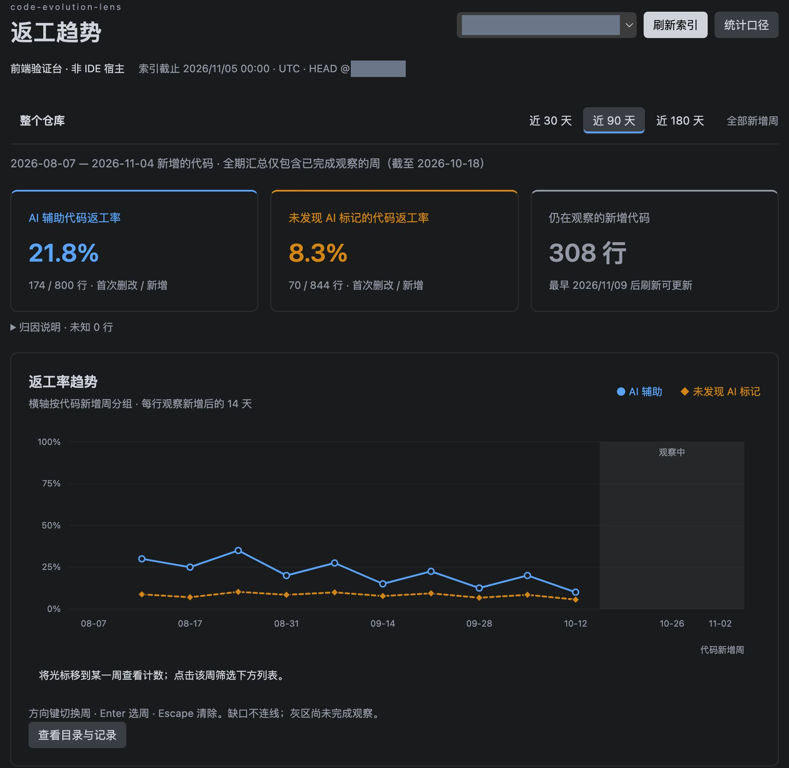
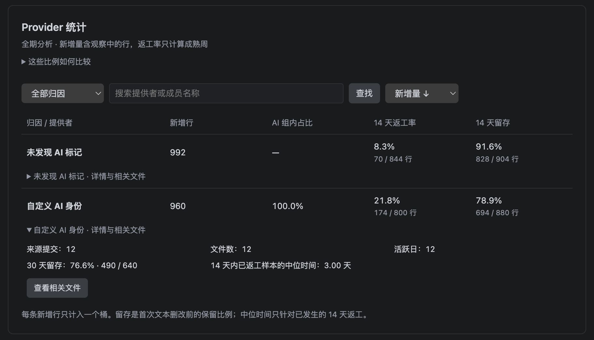
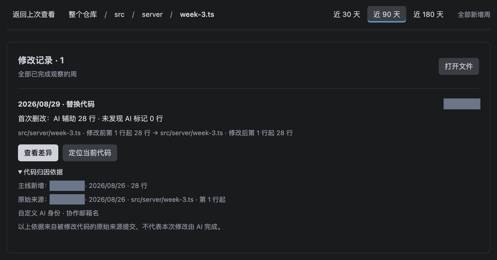

# code-evolution-lens

开发预览 **0.3.4**。在 IDE 主编辑区查看**整个仓库 → 目录 → 文件**的 AI 辅助与未发现 AI 标记两组代码的返工率曲线、provider 统计、代码留存及提交改动，点击某一周筛选修改记录，再打开历史差异。支持在本地或 SSH／容器／WSL 工作区宿主运行。

English guide: run **code-evolution-lens: View Methodology** in an English IDE. The guide is bundled as `README.en.md`.

默认查看近 90 天，可切换 30／90／180 天。蓝色实线表示 AI 辅助，橙色虚线表示未发现 AI 标记。左侧“仓库与目录”用于导航，点击节点切换曲线；打开其他编辑器不会改变统计范围。

真实 Git、远端宿主路径与浅克隆恢复已由自动化测试覆盖；扩展在各兼容宿主中的实际安装、原生 diff 和行标记仍需在对应环境验收。

## 界面示例

以下是实际趋势前端读取临时 Git 演示历史后的截图，不是生产仓库数据，也不代表原生 IDE 验收。仓库标识、作者姓名及提交标识已用不透明色块覆盖，PNG 不保留原始像素与元数据；图中的 `src/server` 等路径来自合成样例。

**仓库趋势**：切换 30／90／180 天，对比两组已完成观察的返工率；灰色周段仍在观察。



**Provider 与留存统计**：查看提供者分组、样本行数和后续留存，展开获取分母及来源统计。



**文件修改证据**：从目录进入文件，展开归因依据；“查看差异”在 IDE 中打开历史版本。



## 安装与开始

1. 当前开发预览可选择 **从 VSIX 安装**，选取 `code-evolution-lens-0.3.4.vsix` 并按提示重载。发布到 Marketplace 后，可在 VS Code 或兼容 IDE（包括 Trae）中搜索 **code-evolution-lens**；SSH／容器／WSL 请先连接远端，在该窗口安装到远端扩展宿主。
2. 打开并信任 Git 仓库根目录，仓库所在宿主需要安装 Git 并可从 PATH 启动。多根工作区逐仓库展示；浅克隆请按下方步骤补全历史。
3. 默认 AI 识别已启用。内部工具统一通过 `codeEvolutionLens.aiProviders` 配置邮箱名与名称词。
4. 执行 **code-evolution-lens: 刷新索引**。首次激活不会自动扫描历史。
5. 点击左侧 **code-evolution-lens → 仓库与目录** 的仓库、目录或文件；也可从状态栏或命令 **打开返工趋势** 进入主面板。
6. 点击曲线中的某一周，筛选该周新增代码的后续返工。进入文件后点击 **查看差异**，在相邻编辑器组打开只读历史 diff。
7. **打开文件** 和 **定位当前代码** 是独立操作；曲线不会随编辑器切换。修改记录支持展开“代码归因依据”。

从 0.1.x 升级后需要刷新重建索引。旧缓存不含 180 天数据，不能继续用于曲线。旧“详情模式”“跟随编辑器”“包根分组”设置已不再使用；现在统一使用主编辑区面板和真实目录层级。

0.3.0 增加提交汇总和来源作者身份，旧索引需完整刷新一次。默认保留 68 类 Agent，仍仅按当前 provider 配置识别。已自行填写 `aiProviders` 的用户使用自己的数组；需要新增默认项时，请从完整示例追加。之后主线、截止日期、过滤和回放规则未变化时，完整缓存只重算来源；其他变化仍重建。完成前保留上次结果并标记过期。

### 新增统计

Provider 表默认显示新增行、AI 组内占比、14 天返工率与 14 天留存；展开每行可查看来源提交、文件数、活跃日、30 天留存和已返工样本的中位响应时间。名称搜索也匹配多提供者成员，支持排序及“查看相关文件”。多提供者与共享邮箱证据分别进入互斥桶，行数不重复计算。

可展开“代码在首次修改前保留了多久”“改动与活跃度”“文件改动、共同修改与贡献集中度”。包含右删失的 KM 留存估计、非空增删量、每日提交、重复编辑、活动区间、修复／回滚标题、共同修改文件、来源作者及关注文件。仓库／目录／文件和 30／90／180 天筛选作用于全部指标；点击某一周仍只筛选原有目录及返工列表。

### 连续查看与键盘操作

图表下直接展示目录或修改记录。“查看本周结果”跳到结果区，固定范围栏可随时清除周筛选。“返回上次查看”恢复来源列表、查询及滚动锚点。搜索、排序、展开模块和事件依据保存到工作区；重开后恢复，索引变化后只保留仍有效的对象。

目录、文件统计、共同修改、作者与关注列表支持完整范围搜索、排序和加载更多；“仅显示有样本项”是展示过滤，不改变分母。Provider 相关文件使用同一归因桶，进入文件后查看完整修改记录。

周图只有一个 Tab 入口，用左右方向键切换周、Enter 选周、Escape 清除，Home／End 到首尾周。每日活动提供日期输入与前／后 14 天文字明细。留存图自带两组图例与口径解释。

从 0.3.0 升级无需为本次界面改动重新回放 Git；原索引过期时仍按通常规则手动刷新。

指标定义、分母、缺口处理与限制见随包 `METRICS.md`。提交活动不是工时，标题声明不是缺陷证据，留存不是代码质量。

### SSH／容器／WSL 工作区

扩展声明 `extensionKind: ["workspace"]`。Git、索引 worker、SQLite WASM 和缓存都在仓库所在宿主运行；Webview 通过 IDE 资源 URI 加载，不需要额外开放网络端口，也不需要在宿主安装 SQLite。只装在本机的扩展需要移到远端安装，不能用本机 Git 读取远端路径。

可执行 **Developer: Show Running Extensions**（显示正在运行的扩展）核对运行位置，再执行 **code-evolution-lens: 显示宿主诊断** 查看扩展版本、remote、extensionKind、资源 scheme 与仓库状态。插件使用宿主时区划分统计周和截止日期。

### 提示“浅克隆”时

面板直接显示以下步骤，仓库树的悬浮提示也包含命令：

1. 点击 **打开仓库终端**。终端起始目录为当前仓库；远端工作区使用同一远端窗口的终端。执行 `git remote -v` 确认上游地址。
2. 执行 `git fetch --unshallow`，从默认上游补全历史。默认上游不正确时指定远程名，例如 `git fetch --unshallow origin`；用实际远程名替换 `origin`。
3. 执行 `git rev-parse --is-shallow-repository`，确认输出为 `false`。
4. 回到插件点击 **刷新索引**，无需重载窗口。

`fetch --unshallow` 会联网下载缺失历史，可能占用较多时间和磁盘；不合并、不切换工作树分支。插件只提供步骤和空终端，不自动执行 fetch。

- 没有远程地址：执行 `git remote add origin <仓库URL>`（替换占位符），或另行克隆完整仓库，不使用 `--depth`／`--shallow-since`／`--filter`。
- 认证或网络失败：在同一远端终端处理 SSH 密钥、仓库访问权限和网络连接，再重试。
- 提示仓库已经完整：运行检查命令，输出 `false` 后直接刷新。
- 仍输出 `true`：上游也可能是浅克隆，或没有提供所需分支历史，需要完整上游。只增加 `--deepen` 或下载最近 90 天，未必能满足从根回放的要求。

## 配置与默认示例

### 界面语言

中文作为源码与配置说明的默认文案，英文提供完整翻译。界面跟随 IDE 的显示语言：`zh-cn` 显示简体中文，英文及未支持的语言（包括繁体中文）显示英文。修改 IDE 显示语言并按提示重启后生效，无需独立设置插件语言或重建索引。SSH／容器／WSL 也使用 IDE 传入的显示语言，不读取服务器 `LANG` 或浏览器语言。

命令、设置和视图名称使用 `package.nls.zh-cn.json` 保存中文源文案，`package.nls.json` 保存英文。VS Code 固定使用 `package.nls.json` 兜底，因此这个文件必须为英文。运行时和 Webview 共用中文翻译键及 `l10n.en.json` 英文词典；构建检查缺失译文和占位符不一致。作者姓名、仓库路径、提交正文和 AI 匹配规则保持原文；只改变展示语言，不改变统计窗口、分母或索引时区。中文行标记 `改` 在英文界面显示为 `rw`。

命令“查看统计口径”随界面语言打开本说明或 `README.en.md`。源码提供双语说明文件，Markdown 本身不会由 IDE 自动翻译。

设置中搜索 `@ext:luorAx.code-evolution-lens`，或编辑仓库 `.vscode/settings.json`。现在仅保留以下 5 项；每项都有默认值、中文说明及示例。完整可复制示例见随包的 `code-evolution-lens.settings.example.jsonc`，它与配置界面及运行时使用同一个默认值来源。

| 配置项（省略 `codeEvolutionLens.`） | 默认值 | 示例与含义 |
|---|---|---|
| `ref` | `"HEAD"` | 分析当前检出的提交；可改为 `"main"` 或已存在的 `"origin/main"`。不自动 fetch。 |
| `aiProviders` | 68 类 Agent 的完整规则 | 直接增删或修改数组中的对象；主说明包含六个字段的机制和示例，子字段也有说明和补全模板。 |
| `detectAiMessageMarkers` | `false` | 设为 `true` 后额外识别正文、标题标签和前缀；结尾归因声明不受此开关影响。 |
| `excludeGlobs` | 依赖目录、构建产物和锁文件的 9 条规则 | 例如添加 `"**/thrift_gen/**"` 排除生成目录。 |
| `decorations.enabled` | `true` | 显示普通字重、描述文本主题色的 `ai`／`改`；悬浮查看详情。设为 `false` 隐藏，统计仍保留。 |

`aiProviders`、`excludeGlobs` 的自定义数组各自替换本项默认值。需要保留默认项时，在默认数组上编辑；删除的默认规则不会被程序补回。邮箱名只在 provider 的 `emails` 中维护；将 `aiProviders` 设为 `[]` 即关闭识别。

设置界面中的 `aiProviders` 主说明直接列出 `provider`、`nameTokens`、`emails`、`bracketTags`、`messageMarkers`、`subjectPrefixes` 的作用，无需展开数组子字段。纯文本说明与 Markdown 说明均保留，适配宿主的显示方式。

### provider 内的字段怎么填

`provider` 是必填的显示名称，其他字段至少填一项。匹配字段都使用字符串数组；不用的字段可省略或填 `[]`。多个字段、数组中的多个值采用“任意一项命中”。

| 字段 | 应该填写 | 配置 → 命中示例 | 需要正文识别开关 |
|---|---|---|---|
| `provider` | 工具显示名称，字符串；本身不参与匹配 | `"Claude Code"` → 归因详情显示此名称 | 不适用 |
| `nameTokens` | 结尾 `Co-Authored-By`／`Generated-By`／`Assisted-by`／`Created-by` 名称中的工具关键词或短语，不填整行声明、邮箱或正则 | `["claude"]` → `Co-Authored-By: Claude Sonnet 4.6 noreply@anthropic.com` | 不需要 |
| `emails` | `@` 前的完整邮箱名，不填域名；匹配作者、提交者和结尾声明 | `["internal-codebot"]` → `internal-codebot@company.example` | 不需要 |
| `bracketTags` | 标题方括号内的标签，不带方括号 | `["claude"]` → 标题 `[claude] 增加权限缓存` | `true` |
| `messageMarkers` | 提交消息中的固定文字，不使用正则或通配符 | `["Generated with Claude Code"]` → 标题或正文包含这段文字 | `true` |
| `subjectPrefixes` | 标题开头的固定前缀，包含冒号等标点 | `["aider:"]` → 标题 `aider: 修复权限校验` | `true` |

“正文识别开关”指 `codeEvolutionLens.detectAiMessageMarkers`，默认 `false`。名称、邮箱和消息匹配均忽略大小写。`nameTokens` 按词边界匹配：`claude` 覆盖型号与版本后缀，但不匹配 `McClaude`；普通作者／提交者姓名不参与名称匹配。归因声明块位于消息末尾，与正文隔一个空行。`bracketTags` 使用 2—31 个英文字母、数字、空格或 `_ . -`，首位为字母或数字；`["[claude]"]` 是错误填写方式。标题前缀后直接连接字母、数字或下划线时不匹配，建议冒号后跟空格。

只按 Claude 名称识别的最简示例：

```json
{
  "codeEvolutionLens.aiProviders": [
    {
      "provider": "Claude Code",
      "nameTokens": ["claude"]
    }
  ]
}
```

此示例替换整个默认 provider 数组，仅保留 Claude 名称规则。每个 provider 至少填写一项非空匹配规则；配置错误只影响该仓库，修正后刷新索引即可恢复。实际邮箱配置只接受 `["noreply"]` 这样的名称，`["noreply@anthropic.com"]` 会报错；Git 记录中的完整邮箱仍正常解析。程序不读取独立 `aiEmails`，不做历史配置转换或迁移。

索引会完整计算差异，不再因为时间或数据量阈值停止。可随时点击“取消”：发布批准前取消保留上次结果；完成候选持久化并获宿主批准后，当前仓库完成发布并显示新结果，后续仓库停止索引。读取或写入失败保留上次结果。窗外无跟踪版本仍按需跳过正文，缓存仍会淘汰旧对象以减少内存保留。机器和 Node 自身可用内存仍决定实际可处理规模。

结尾归因 trailer 需要有正文，并用空行分隔。只有一行 `Co-authored-by: Claude` 的标题不参与默认 trailer 归因。0.3.3 升级归因规则指纹，已有索引会提示刷新；刷新时重新计算归因。示例：

```text
实现某项功能

Co-authored-by: Claude <noreply@anthropic.com>
```

以下无尖括号格式也支持，无需开启正文启发式识别：

```text
实现某项功能

Co-Authored-By: Claude Sonnet 4.6 noreply@anthropic.com
```

## 默认 AI 判断与扩展

原有 11 类签名的固定来源和 MIT 许可保留在 `THIRD_PARTY_NOTICES.md`。2026-11-09 核对官方资料、Vulnetix、skills-manager 和 Trellis 社区目录后，默认扩充为 **68 类产品家族**。完整清单、每项来源和公开 Git 模式见随包 `PROVIDERS.md`，完整规则见 `code-evolution-lens.settings.example.jsonc`；没有引入 Python 或在线识别服务。

以下列出用户关心的产品及部分公开邮箱示例；全部 68 类以来源清单和完整默认配置为准。

| 默认提供者（节选） | 默认邮箱名（不含域名） | 结尾 trailer 名称词（节选） |
|---|---|---|
| Claude Code | `noreply` | `claude` |
| GitHub Copilot | `copilot`、`copilot-swe-agent`、`copilot-swe-agent[bot]` | `copilot` |
| Cursor | `noreply`、`agent`、`cursoragent` | `cursor` |
| aider | `aider` | `aider` |
| OpenAI Codex | `codex` | `codex` |
| Devin | `devin`、`devin-ai-integration`、`devin-ai-integration[bot]` | `devin` |
| TRAE | 未查实，未配置 | `trae`、`traecode`、`traework` |
| Qoder | 未查实，未配置 | `qoder` |
| OpenClaw | 未查实，未配置 | `openclaw` |
| Pi Coding Agent | 未查实，未配置 | `pi`、`pi coding agent` |
| Amp | `amp` | `amp`、`ampcode` |
| Factory Droid | `factory-droid[bot]` | `factory droid` |
| OpenHands | `openhands`、`openhands-ai[bot]` | `openhands` |
| Google Jules | `google-labs-jules[bot]` | `jules` |

新增名称规则只识别显式声明，不证明产品会自动生成这些声明；标题标签是可用的显式约定，也不代表厂商默认行为。Pi 的 `Generated-By: pi 0.63.2` 来自 `pi-co-authored-by` 社区扩展，启发式关闭时也可识别。没有 Git 标记时，工具即使在默认名单中仍可能显示“未发现 AI 标记”。工具可以只写模型名称，因此不能仅凭名称严格区分工具与模型。

默认判断规则：

- 作者／提交者的邮箱名精确命中即可认定该提交带 AI 标记。名称忽略大小写、去除两端空白、忽略域名；`codex@a` 和 `codex@b` 都匹配 `codex`，`mycodex` 不匹配。仅凭作者名称叫 Claude 或 Cursor 不作判断。
- GitHub 隐私邮箱中的 `198982749+` 是数字账号 ID 前缀。默认配置只写 `copilot-swe-agent`，读取 `数字ID+名称@users.noreply.github.com` 时增加账号名称别名；支持不同数字 ID。这个特例只用于 GitHub noreply 域，普通邮箱的加号及数字前缀不会被删除。
- 通用名 `noreply`、`agent` 可能对应人工或其他机器人；邮箱名匹配会扩大归因范围。同一邮箱名属于多个提供者时，依据显示“AI 邮箱名（提供者不唯一）”，不会把它确定为某个工具。
- 结尾 `Co-authored-by`、`Generated-by`、`Assisted-by`、`Created-by` 使用邮箱名或名称词匹配，键名与名称均忽略大小写。支持 `Name <email>`、`Name email`、纯名称、纯邮箱；例如名称词 `claude` 可识别 `Claude Sonnet 4.6`。保留完整词／短语边界，`McClaude`、`MyCursor` 不命中；坏尖括号、多个邮箱和正文样例不会放宽为名称证据。Git 提交里的邮箱仍然是完整地址，仅配置使用邮箱名。
- 正文 “Generated with…”、标题 `[claude]` 等标签及 `aider:` 前缀默认关闭；可开启 `codeEvolutionLens.detectAiMessageMarkers`。这些启发式可能误判；Git notes 和提交频率推断未接入。
- 命中依据保存在新增代码记录中，修改记录显示“作者邮箱”“协作名称”“标题标签”等信号与提供者，不输出未经校准的置信度。
- 普通 merge 对新增行追溯全部父分支的原始来源提交，按原提交标记区分 AI／未发现 AI 标记；同一合并可包含两类代码。合并时新写、冲突解决或来源文本无法核验的行单列为未知。清空全部有效签名时显示“未配置识别”，不强行归入任一组。

只使用内部工具的示例（如需保留默认项，请把新对象加入完整默认数组）：

```jsonc
{
  // 开启后，以下三类消息字段才参与匹配
  "codeEvolutionLens.detectAiMessageMarkers": true,
  "codeEvolutionLens.aiProviders": [
    {
      // 用于归因详情显示，不作为匹配词
      "provider": "内部编码助手",
      // 匹配 Co-Authored-By: Internal Coding Bot 2.0 bot@example.test 中的名称
      "nameTokens": ["internal coding bot"],
      // 匹配 coding-bot@任意域名 或 other-bot@任意域名
      "emails": ["coding-bot", "other-bot"],
      // 匹配标题：[internal-ai] 增加功能
      "bracketTags": ["internal-ai"],
      // 匹配提交标题或正文中包含的固定文字
      "messageMarkers": ["Generated with Internal Coding Bot"],
      // 匹配标题开头：internal-ai: 增加功能
      "subjectPrefixes": ["internal-ai:"]
    }
  ]
}
```

`aiProviders` 只合并当前生效数组中同名 `provider` 的显式签名。后面三类消息字段需要启发式开关。配置采用字面字符串，不接受正则；子字段为空数组表示不启用该类签名。

如需只采用邮箱名识别，provider 对象只填写 `provider` 与 `emails`；只采用名称时，只填写 `provider` 与 `nameTokens`。两者都填写时，任一命中即可作为依据。修改归因规则后请刷新索引；刷新完成前展示的仍是上次结果。

## 指标口径

**返工率 = 新增后 14 天内首次被删除或替换的非空行数 ÷ 新增非空行数。** AI 辅助和未发现 AI 标记两组使用相同口径。它描述文本变化，不等同于缺陷率，也不能证明 AI 导致了返工。

每个图表点对应一周新增的代码。周一开始，所选范围两端不足一周时截断；按索引记录的本地时区划分日期。每条新增行观察 `14 × 24 小时`，第 14 天整发生的首次删改计入，晚一秒不计。同一行只计第一次删改；重新引入相同文本是新的新增行。

- 截止时间是索引当日本地零点。记录近 180 天新增代码；切换 30／90／180 天无需重新索引。
- **整个周段都完成观察后，才显示最终比例。** 因此曲线通常会有最近 14—20 天的灰色区域；这些新增行显示在“仍在观察”，不混入汇总分母。
- 顶部卡片汇总所选时间范围内已完成观察的周。父级按行数相加后计算比例，不平均百分比。点选周只筛选下方列表，顶部汇总与整段曲线保持不变。
- AI 辅助表示原始来源提交命中 AI 标记，仍是提交级证据，不能证明该提交每行都由 AI 编写。未发现 AI 标记表示未命中标记，可能包含未声明的 AI 使用。合并带入行通过 Git blame 及完整规范化物理行比对核验来源，合并新写行与未核验行不进入两组比例。
- 主线首次出现代码的提交、时间和位置始终保留；原始来源提交仅用于归因。14 天观察从主线新增时间开始，不提前到分支提交时间。普通单父提交（含 squash）直接使用该主线提交的归因。
- 没有样本显示“无样本”；有样本且没有返工才显示 `0.0%`。历史读取不完整的受影响周不显示比例，曲线遇到无样本或缺口会断开。
- 目录按所选 ref 的当前文件路径组织。跨目录重命名后，文件的历史随当前路径归属；已删除文件保留在最后路径。同名文件删除后重建是两个独立身份。
- 没有近期新增行的当前文件仍可导航。排除状态可见；筛选在代码新增时确定，已计入的代码移入排除路径后仍继续观察。
- 新增指进入所选 ref 的 first-parent 主线。合并前分支内的修改不在观察范围。已删除的新增行仍属于原分母。
- 空白行不计数，但保留物理位置。UTF-8、CRLF 归一为 LF；末尾换行状态会影响差异。固定 `diff@8.0.4` 行级 Myers；Git rename 使用 50% 阈值、1000 候选上限。
- raw diff 使用隔离的临时 bare 元数据，只读共享原仓库对象，避免工作树 attributes 与用户 diff 配置改变统计。

## 修改记录与当前定位

文件修改记录只展示与当前统计分子有关的首次删改；点选周后只显示该周新增代码在随后 14 天内的返工。记录给出被删改的两组行数、提交、修改前后位置及归因依据，并区分“主线新增”与“原始来源”的提交、日期和行位置。一个 diff hunk 可能包含其他行，完整差异与计数筛选范围有所不同。

历史 diff 两侧都是 Git blob 的只读虚拟文档。纯删除、区域再次被修改后，只提供历史位置。仍可核验的替换区域提供“定位当前代码”，不承诺新旧行的语义继承。

当前定位与编辑器 `ai`／`改` 标记同时要求：所选 ref 和工作区 HEAD 都等于索引时的提交；编辑器未修改；磁盘与编辑器文本和 Git blob 一致。统计 ref 可以不同于当前分支，这时曲线仍可使用，精确当前定位不可用。滚动复用已核验结果并原子覆盖可见区域，同文档分栏独立；编辑、仓库或配置事件会撤销旧结果，定期刷新仍重新核验。

日期、配置或统计 ref 变化时保留上次结果并提示刷新。外部变化由文件监听、窗口激活与 15 秒复核发现。后台索引可取消，失败或取消不会发布半成品。面板的范围、天数、选中周保存到工作区状态；隐藏期间不持续发送整页，恢复时发送最新结果。

## 支持边界

- 插件声明 VS Code API `^1.95.0`，采用 Node 扩展宿主，随包携带 SQLite WASM。
- 支持本地及 SSH／容器／WSL 工作区的普通 Git 仓库。浅克隆需按面板步骤补全后索引；**partial clone、sparse checkout、子模块和纯虚拟文件系统暂不支持。**
- 无 LLM、无遥测、无自动 fetch。插件不修改用户仓库的提交、分支、工作树或 Git 配置；不运行外部 diff、textconv、hooks。
- SQLite 快照只写扩展 `storageUri/index`。raw diff 另使用系统临时目录中的无源码 bare 元数据，正常结束即删除。
- 从根核验所有主线提交的时间、路径与 rename，使用受控对象缓存。正文按需回放：窗口内有新增资格，或文件仍有存活的已计入行／当前定位区域时，才读取并计算差异；其他版本只保存文件身份、路径与 blob。未读取的旧行在首次需要时按真实父版本补齐物理占位，不当成新增。尚未启用 checkpoint 或增量索引。
- `work.objectBytes` 只统计必要正文的实际读取量；`excluded.objects/bytes` 统计读取后确认不能解析的版本，`excluded.knownLines` 只统计已计算差异中不符合资格的新增物理行。被路径规则直接排除的未读取版本没有估算行数。
- SQLite 使用不可变快照文件及原子 active 指针。候选在内存中构建，再整体导出 SQLite；尚未分批持久化。会话内保留已用历史快照，下次激活清理没有引用的旧快照。
- 不设提交数、单文件大小、累计读取量、行数、总时长、单文件差异时长上限；也移除了 Git 查询的输出量／超时上限和插件设置的 512 MiB worker 堆上限。Git 路径与对象协议核验、读取失败处理和手动取消仍保留。
- 10 万提交仓库的冷索引性能、交互 P95、长期峰值内存尚未测试。移除人为上限不代表无限的系统内存或性能承诺。

## 开发与验证

构建机需要 Node.js 22 或更新版本；Git 用于测试和运行。

```sh
npm ci
npm run check
npm run build
npm test
npm audit
npm run package
python3 scripts/smoke-vsix.py
```

测试仓库在系统临时目录中生成并清理。`npm test` 包括真实 Git 回放、SQLite、打包 worker、趋势、DOM 交互和控制器消息；运行前需 build。

趋势前端验证台：

```sh
node scripts/preview.mjs
```

访问 `http://127.0.0.1:4173`。验证台临时创建真实 Git 历史，使用实际 `TrendQuery`、`media/trends.js` 与 CSS。前端动作通过本地消息接口切换报告；“打开文件”“查看差异”仅记录消息，不代表在真实 IDE 宿主中的操作。测试依赖不打包进 VSIX。

源码分层：`package.json` 为默认配置与签名的唯一来源，`ai-providers.ts` 导出类型与签名引用，`attribution.ts` 编译规则；`git.ts` 读取固定对象，`replay.ts` 回放新增、首次删改及提交活动，`origin.ts` 核验来源与作者，`store.ts` 原子发布；`time.ts` 定义时区周边界，`trends.ts` 计算范围趋势，`metrics.ts` 计算 provider、留存和活动统计；`presentation.ts` 验证消息，`trends-panel.ts` 管理面板，`webview.ts` 渲染曲线与统计；`runtime.ts` 调度，`tree.ts` 导航，`decorations.ts` 标记当前行，`history.ts` 提供只读历史对象。

诊断命令只输出宿主、版本、快照和工作量，不输出源码、提交正文或邮箱。当前版本行为以此说明与更新记录为准。

发布步骤和提交范围见 [PUBLISHING.md](PUBLISHING.md)，当前验证结果见 [VALIDATION.md](VALIDATION.md)（源码仓库提供，不打包进 VSIX）。
